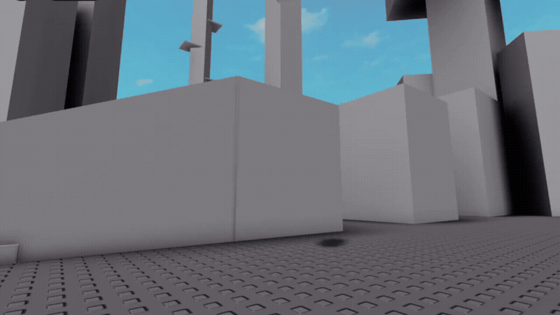
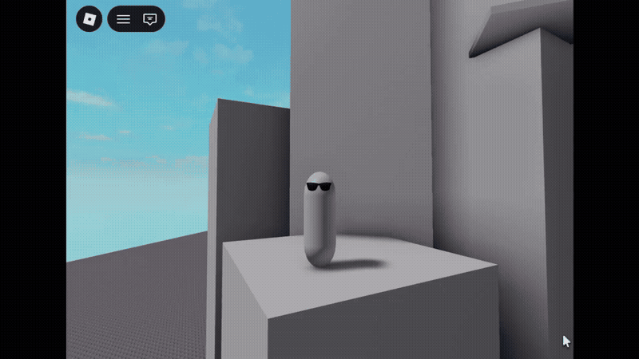

<div align="center">
  <h1><strong>Vertex v0.12.5</strong> </h1> 
   
  
  ***Cool Bean Approved***
</div>

Vertex is a decoupled, state and component driven framework for Roblox player character creation. 
It is designed to alleviate the burden of how character scripts intertwine, allowing developers to focus on gameplay depth instead of technical debt.

## Features
* **Dynamic Module Discovery**

<p align="center">
  
</p>

Vertex will automatically load any state or component modulescripts, creating instant functionality with minimal adjustments to how it works with other scripts. Want to add functionality for running or crouching? Just add a State, Component, or multiple, whichever suits your needs best!

* **Automatic keybinding**

<p align="center">
  
</p>

Vertex will automatically bind any specified Component functions to their respective keybinds, eliminating the overhead of managing input connections manually.

* **Customizable API & architecture**

Vertex is designed from the ground up to be transparent with how it functions, enabling developers to modify its contents to better fit their own needs.

## Quick Start Guide
<div align="center">
For a complete implementation example, including multiple state transitions, use of components, and abilities, explore the Vertex Demo place, uncopylocked on Roblox or available for download in the releases tab.

* [Vertex Demo - Roblox](https://www.roblox.com/games/95530238964993/Vertex-Demo)
</div>

* **Installation**

  * Download Vertex

  You can download Vertex through the [releases tab](https://github.com/JRmcnugget/Vertex/releases), or alternatively, edit the [uncopylocked demo on the Roblox website](https://www.roblox.com/games/95530238964993/Vertex-Demo). 

  * Setup


  Place the VertexLib folder within ReplicatedStorage, and the Vertex localscript within StarterPlayerScripts.

  If you are utilzing the Demo file, place the StarterCharacter model into StarterPlayer.

  Modify VertexConfig's initialState line, replacing "ExampleState" with the string of the state's name the player should begin in.

  You should be ready to go!

<hr />
  
* **Creating a State**

State modules follow the format of:
```lua
-- Required for proper metatable inheritance. Should not be deleted. 
local State = {}
State.__index = State

-- Returns the contents of the state to be loaded into memory by Vertex.
function State.new(Manager)
    local self = {
        Manager = Manager, -- links back to Vertex. Generally should not be modified
        Name = "ExampleState", -- The name of the state as a string. 
        interruptable = true, -- Identifies whether the state can be cancelled or not.
    }
    return self
end

-- Triggers upon the state being swapped to from another state. Should be used for any state specific initialization
-- State:onUpdate() will not run until this returns true.
function State:onEnter(dt)
    return true
end

-- Ran every frame while this state is active.
function State:onUpdate(dt)
end

-- Triggers upon the state being swapped out of. Should be used for any state specific cleanup.
-- The state that is being swapped to will not have its onEnter() run until this function returns true.
function State:onExit(dt)
    return true
end

return State
```
Both ```State:onEnter()``` and ```State:onExit()``` are not necessary for a state to function, but it is recommended to leave them blank regardless of their utilization. ```State.new()``` and ```State:onUpdate()``` are required.

States waiting until ```State:onEnter()``` or ```State:onExit()``` has completed allows developers to utilize asynchronous transitions. If you need to wait for an animation, a sound, or something else to finish before the state officially begins or ends, you can postpone the return utilizing a ```task.wait()```.

Inside any state hook, you have full access to the Vertex API through ```self.Manager```. For example:
* Referencing the player: ```self.Manager.Player```
* Accessing a shared variable: ```self.Manager.Shared.isCool = true```
* Requesting to change a state: ```self.Manager:changeState("Jumping")```

States are referenced in code by their name variable. They will default to the filename of the modulescript unless specified in their ```self``` table. For example:

* A state with the line ```Name = "epicState"``` will be referenced as ```epicState```.
  
  * eg. ```self.Manager:changeState("epicState")``` or ```self.Manager.States["epicState"]```

 * A state with no line for name, but has the file name "ExampleState" will be referenced as ```ExampleState```.

States inherit default variables written in ```VertexManager.StateDefaults```. You are able to overwrite the default by writing the new value within the State's ```self```, within ```State.new()```. For example:

* For:
  ```lua
  VertexManager.StateDefaults = {
    isEpic = false,
    canJump = false
  }
  
  &
  
  function State.new(Manager)
    local self = {
        Manager = Manager,
        Name = "ExampleState",
        isEpic = true
    }
    return self
  end
  ```
  
  * ```self.isEpic``` will print ```true```
  * ```self.canJump```will print ```false```

<hr />

* **Creating a Component**

Component modules follow the format of:

```lua
-- Required for proper metatable inheritance. Should not be deleted. 

local Component = {}
Component.__index = Component

-- Returns the contents of the component to be loaded into memory by Vertex.
function Component.new(Manager)
    local self = {
        Manager = Manager, -- links back to Vertex. Generally should not be modified
        Name = "ExampleComponent", -- the name of the Component, in a string
        updateFrequency = nil, -- identifies how often, in times per second, the Component:onUpdate() should be called
        accumulator = 0, -- used to track how much time has passed in order to utilize updateFrequency
    }
    return self
end

-- runs every frame, or according to updateFrequency if it is not nil
function Component:onUpdate(dt, dtComplete) 
    
end

-- An event to be binded to by Vertex
function Component:OnExampleEvent(newState) 
    
end

return Component
```
Only ```Component.new()``` is necessary for a component to function. Anything else may be excluded if necessary.

Inside any component hook, you have access to the entire Vertex API using ```self.Manager```. For example:
* Referencing the active state: ```self.Manager.ActiveState```
* Modifying character properties: ```self.Manager.Shared.humanoidRoot.Anchored = true```

Components are referred to in code by their name variable. They will default to the filename of the modulescript unless specified in their ```self``` table.

How often ```Component:onUpdate()``` is called by Vertex can be modified by changing the ```updateFrequency``` variable within the Component's ```self``` table. ```updateFrequency``` specifies how often, in times per second, ```Component:onUpdate()``` will be called. If ```nil```, it will update every frame as usual. For example:
* How often the function will be updated can be calculated using the formula of ```1/updateFrequency```
* An ```updateFrequency``` of 10 will update the function 10 times per second (every 0.1 seconds)
* An ```updateFrequency``` of 30 will update the function 30 times per second (every 0.033 seconds)
* An ```updateFrequency``` that is ```nil``` will update every frame (every 0.0167 seconds for 60fps, every 0.0083 seconds for 120fps)
When a component's ```updateFrequency``` is not default, the variable ```dtComplete``` is passed along with deltaTime (``dt``), which is the total amount of time passed from the component's last update. Use this variable if you are doing anything that requires full knowledge of deltaTime within a component that does not update every frame.

Vertex will bind any functions specified by InputAction instances that are children of the component. These function names are based on the InputAction's name and the componentInputBindPrefix specified within ```VertexConfig```. The function Vertex will look for to bind to can be overridden with a string attribute with the name of "handlerOverride" attached to the InputAction.
For example:
* For a InputAction named "Jump", and the componentInputBindPrefix "On", Vertex will bind the action to the function "OnJump" if found.
* For an InputAction with the name "Crouch", and the handlerOverride attirbute "doCrouch", Vertex will bind the action to the function "doCrouch" if found.

Any binded events are referenced in code through this format: ```componentName.."_"..requestEventName```. For example:
* For a Component with the name "ExampleComponent" and the binded function "exampleFunction", with the prefix "On":
  The binded event would be referenced as: "ExampleComponent_OnexampleFunction"
* For a Component with the name "MovementComponent" and the binded function "doCrouch" from the attribute handlerOverride:
  The binded event would be referenced as: "MovementComponent_doCrouch"

Binded events are parented to the default InputContext specified by VertexConfig's componentDefaultInputContext. This can be overridden by a string attribute with the name of "inputContext" attached to the InputAction. Vertex will create a new InputContext for the specified context name if it does not already exist. These InputContexts are found within the folder referenced by ```VertexManager.InputContexts```. 
For example:
* For an InputAction with the inputContext attribute "ExampleContext", Vertex will parent the action under ExampleContext within ```VertexManager.InputContexts```. 

For binded events such as ```Component:OnExampleEvent(newState)```, the variable ```newState``` varies depending on the type of InputBinding triggered for the InputAction. See Roblox's [Input events documentation](https://create.roblox.com/docs/input/input-action-system#input-events) for details.
  
<hr />

* **Advanced Functionality**

* By default, Vertex utilizes Roblox's new InputActionSystem to bind Component Events. If you have need for an external library to bind functions, you can modify ```VertexManager:createBind()``` for your purposes.
* By default, Vertex creates a folder within the player to store InputContexts, referenced by ```VertexManager.InputContexts```. This can be used for disabling of certain inputs/controls and adjusting InputContext priorities. 
* Shared variables are within ```VertexManager.Shared```. It is recommended to set any player character variables to ```nil``` and instead utilize ```WaitForChild()``` to update them in ```VertexManager:updateCharacter()```.
* Vertex clears all spawned tasks upon cleanup, which is necessary to prevent possible desyncs. If you are using ```task.spawn```, ```task.defer```, ```task.delay```, a ```coroutine```, or something similar that utilizes another thread, it is **heavily** recommened to store it within ```VertexManager.ActiveThreads``` to ensure proper cleanup.

<hr />

## Documentation

* VertexManager

  * **VertexManager.Config**

    DataType = array

    Contains the list of Configs as obtained by the VertexConfig modulescript

  * **VertexManager.ActiveState**
 
    Datatype = array

    Contains a reference to the currently active state

  * **VertexManager.PreviousState**

   Datatype = array
   
   Contains a reference to the previously active state. Is set after the previous component's onExit() finishes.

  * **VertexManager.Player**

    DataType = instance

    A reference to the Player instance of the LocalPlayer

  * **VertexManager.AwaitingSignal**

    DataType = boolean

    Used witin VertexManager:changeState(), yielding State:onUpdate() until it is false

  * **VertexManager.States**
 
    DataType = Array

    Contains a reference to each loaded State

  * **VertexManager.Components**
 
    DataType = Array

    Contains a reference to each loaded Component

  * **VertexManager.InputContexts**

    DataType = Folder

    A reference holding every InputContext created by Vertex. Useful to reference specific contexts during scripting for enabling/disabling of certain controls

  * **VertexManager.ActiveThreads**

    DataType = Array

    Contains a reference to each currently active thread, which is used to kill any active ones during cleanup to prevent desync issues. If you are utilizing anything that creates another thread, it is important to store it within this table

  * **VertexManager.CleanupThread**

    DataType = thread

    Contains a reference to the thread doing the cleanup in Vertex after VertexManager:Cleanup() has been called

  * **VertexManager.BindedEvents**

    DataType = Array

    A table containing all binded component events for reference if needed
    
  * **VertexManager.Shared**
 
    DataType = Array
 
    variables available for ready access across any State or Component
  * **VertexManager.SharedDefault**
 
    DataType = Array
 
    A clone of VertexManager.Shared, so it may reset to it upon VertexManager:Cleanup() is called
  * **VertexManager.StateDefaults**

    base variables and/or capabilites of a state to inherit upon loading

    Anything written in the state's .new() will override these
  * **VertexManager:Init()**

    initializes Vertex for the first time, and sets up a bind to cleanup whenever a new character is added for the player
  * **VertexManager:Cleanup()**
 
    kills all running threads to prevent possible desync issues, and resets all variables
  * **VertexManager:updateCharacter(newModel)**
 
    Passed Variables: instance

    queries the new playermodel for necessary components to be referenced within .Shared
  
    add any references as necessary, utilizing WaitForChild
  * **VertexManager:createBind(func, component, inputAction)**
  
    Passed Variables: function, instance, string
  
    binds the given function using contextactionservice
  * **VertexManager:changeState(newState, override, dt)**
  
    Passed Variables: string (stateName), boolean (true/false), number
  
    requests VertexManager to switch to a new state, as indicated by the newState variable.

    runs each respective state's onEnter() and onExit(), and will ignore state.interruptable if boolean override is true.
  
    if a changestate is requested in the middle of another state change, it will interupt the currently ongoing one in favour of the new state
  
  * **VertexManager:getModules(parent)**
  
    Passed Variables: instance

    helper function to remove redundant code, and gather all valid modules
  * **VertexManager:loadStates()**
 
    load all states into VertrexManager.States, and provide metatable inheritance from .StateDefaults
  * **VertexManager:loadComponents()**
 
    load components into VertexManager.Components, and binds any functions referenced in the components bindableEvents table
  * **VertexManager:update(dt)**

    runs the active state's onUpdate, along with any other components with an onUpdate function
* State
  * **State.new(Manager)**

    returns the state's local variables as identified in self. will inherit any variables from Vertex.StateDefaults
  * **State.Manager**

    DataType = array

    Links back to VertexManager, allowing access to the Vertex API within a state hook
  * **State.Name**
 
    DataType = string
 
    Used as the identifier for the state within code. If not specified, it will default to the file name
  * **State:onEnter(dt)**
 
    runs upon being switched to from another state. will yield State:onUpdate() and Manager:changeState() until returns true.
  * **State:onUpdate(dt)**
 
    runs every frame while the state is active
  * **State:onExit(dt)**
 
    runs upon switching to another state. will yield State:onUpdate(), preventing the next state's onEnter to begin until returns true
* Component
  * **Component.new(Manager)**

    returns the components's local variables as identified in self
  * **Component.Manager**

    DataType = array

    Links back to VertexManager, allowing access to the Vertex API within a component hook
  * **Component.Name**

    DataType = string
    
    Used as the identifier for the component within code. If not specified, it will default to the file name
  * **Component.updateFrequency**

    DataType = int

    specifies how often, in times per second, Component:onUpdate() will be called.
  * **Component.accumulator**

    DataType = number

    keeps track of how much time has accumilated to throttle component onUpdate()s based on their updateFrequency

  * **Component:onUpdate(dt, dtComplete)**

    runs everyframe, unless given a specific update rate by Component.updateFrequency

    dt: current deltaTime
    dtComplete: the time passed from the component's last update, only provided if updateFrequency ~= nil
* VertexConfig
  * **InitalState**
    
    DataType = string

    specifies what state the player should begin in after spawning in. case sensitive
  * **RenderPriority**

    DataType = int

    specifies the render priority to be used for the renderstepped bind
    
  * **printWarnings**

    DataType = boolean

    specifies whether or not Vertex should print warnings

  * **stateFolder**

    specifies where states are to be found. change if necessary
  * **componentFolder**

    specifies where components are to be found. change if necessary

    * **componentInputBindPrefix**

    DataType = string

    specifies what prefix to use in front of the InputAction's name when Vertex looks for the function to bind to the action. if not specified, there will be no prefix

    * **componentDefaultInputContext**

    DataType = string

    specifies the name of the default InputContext instance that Vertex will parent InputActions under unless otherwise specified

    * **componentInputContextDefaultPriority**

    DataType = int

    specifies the default priority level each InputContext will be created with. if not specified, it will default to the InputContext default priority (1000)

    * **componentInputContextDefaultSink**

    DataType = boolean

    specifies the sink mode each InputContext will be created with. if not specified, it will default to the InputContext default sink value (false)

<hr />

Built using Rojo
